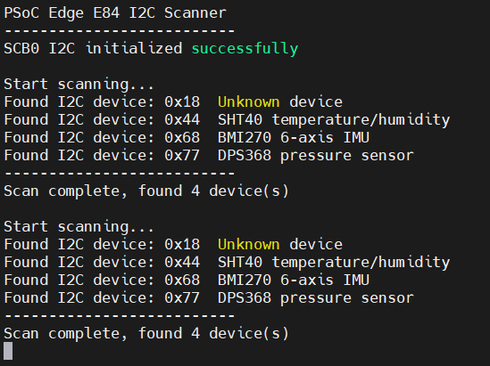
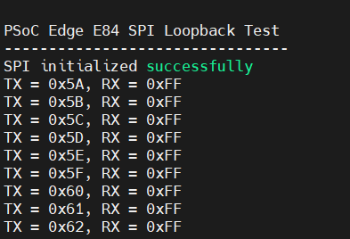
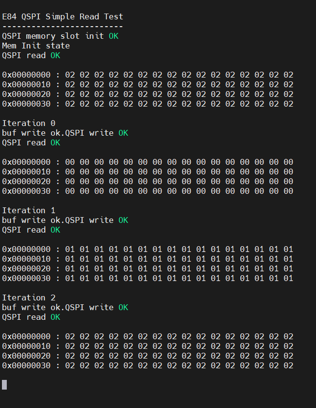

# I2C與SPI簡介

上課教材

- [Infineon PSoC™ Edge E84 AI Kit-17 I2C](https://hackmd.io/S2RI89qLQIqhjwHpII7ZWA?view)
- [Infineon PSOC™ Edge E84 AI Kit-18 SPI](https://hackmd.io/@PowenKo/BysL49abMx)
- [Infineon PSoC™ Edge E84 AI Kit-19 Quad SPI](https://hackmd.io/KNlramWBQMSrDmDwDNTdmg)

## 目錄

- [I2C](#i2c)
- [SPI](#spi)
- [QSPI](#qspi)

## I2C

- [I2C 規格](#i2c-規格)
- [範例程式](#範例程式)
- [結果](#結果)

### I2C 規格

#### 基本接線

```
PSoC Edge E84                         I²C 感測器
─────────────                         ──────────
SDA  ◄──────────────────────────────► SDA (傳送與接收資料)
SCL  ───────────────────────────────► SCL (傳送同步時脈)
GND  ──────────────────────────────── GND
3.3V ──────────────────────────────── VCC
```

#### 裝置關係

```
Controller／Master
    │
    ├── 產生 START
    ├── 產生 SCL 時脈
    ├── 指定 Target 位址
    └── 產生 STOP

Target／Slave
    │
    ├── 比對自己的位址
    ├── 回覆 ACK
    └── 傳送或接收資料

```

#### Open Drain 功能

<table>
    <tr>
        <th>功能</th>
        <th>怎麼運作</th>
    </tr>
    <tr>
        <td>ACK</td>
        <td>Controller 放手 SDA，Target 收到資料後把 SDA 拉低表示「收到了」</td>
    </tr>
    <tr>
        <td>Clock stretching</td>
        <td>Target 還沒準備好時把 SCL 拉住在低電位，Controller 就得等</td>
    </tr>
    <tr>
        <td>多 Controller 仲裁</td>
        <td>兩個 Controller 同時傳，誰想送 1 卻發現線是 0，就知道自己輸了，自動退出</td>
    </tr>
</table>

#### 上拉電阻值怎麼選

<table>
    <tr>
        <th></th>
        <th>電阻小（如 2.2 kΩ）</th>
        <th>電阻大（如 10 kΩ）</th>
    </tr>
    <tr>
        <td>從 0 回到 1 的速度</td>
        <td>快</td>
        <td>慢</td>
    </tr>
    <tr>
        <td>拉低時流過的電流</td>
        <td>大，比較耗電</td>
        <td>小，省電</td>
    </tr>
    <tr>
        <td>適合</td>
        <td>400 kHz 以上的高速、線比較長</td>
        <td>100 kHz 低速、低功耗</td>
    </tr>
</table>

#### 7-bit I2C 位址

7-bit 位址範圍理論上為：

```
0x00～0x7F
```

但部分位址屬於保留位址。掃描程式通常掃描：

```
0x08～0x77
```

常見位址:

<table>
    <tr>
        <th>裝置</th>
        <th>常見位址</th>
    </tr>
    <tr>
        <td>SSD1306 OLED</td>
        <td>0x3C 或 0x3D</td>
    </tr>
    <tr>
        <td>BMP180</td>
        <td>0x77</td>
    </tr>
    <tr>
        <td>DPS310</td>
        <td>0x76 或 0x77</td>
    </tr>
    <tr>
        <td>ADXL345</td>
        <td>0x53 或 0x1D</td>
    </tr>
    <tr>
        <td>MPU6050</td>
        <td>0x68 或 0x69</td>
    </tr>
    <tr>
        <td>24LC 系列 EEPROM</td>
        <td>常見為 0x50 起</td>
    </tr>
</table>

#### 寫入暫存器的流程

```
START
  ↓
Target Address + Write
  ↓ ACK
Register Address 0x10
  ↓ ACK
Data 0x55
  ↓ ACK
STOP
```

#### 讀取暫存器的流程

```
START
  ↓
Target Address + Write
  ↓ ACK
Register Address 0x10
  ↓ ACK
RESTART
  ↓
Target Address + Read
  ↓ ACK
Read Data
  ↓ NACK
STOP
```

### 範例程式

```
#include "cy_pdl.h"
#include "cybsp.h"
#include "cycfg.h"
#include "retarget_io_init.h"

#include <stdio.h>
#include <stdint.h>

/* I2C 每次操作的逾時時間，單位為毫秒 */
#define I2C_TIMEOUT_MS    (100UL)

/*
 * Device Configurator 沒有自動產生
 * CYBSP_I2C_CONTROLLER_context，
 * 因此由程式自行建立。
 */
static cy_stc_scb_i2c_context_t i2c_context;

/* 函式宣告 */
static void i2c_scan(void);

int main(void)
{
    cy_rslt_t result;
    cy_en_scb_i2c_status_t i2c_status;

    /* 初始化開發板、時脈、GPIO 與周邊設定 */
    result = cybsp_init();

    if (result != CY_RSLT_SUCCESS)
    {
        CY_ASSERT(0);
    }

    /* 啟用全域中斷 */
    __enable_irq();

    /* 初始化 printf UART */
    init_retarget_io();

    printf("\x1b[2J\x1b[;H");
    printf("PSoC Edge E84 I2C Scanner\r\n");
    printf("--------------------------\r\n");

    /*
     * 初始化 SCB0 I2C。
     *
     * CYBSP_I2C_CONTROLLER_HW = SCB0
     * SDA = P8[1]
     * SCL = P8[0]
     */
    i2c_status = Cy_SCB_I2C_Init(
        CYBSP_I2C_CONTROLLER_HW,
        &CYBSP_I2C_CONTROLLER_config,
        &i2c_context);

    if (i2c_status != CY_SCB_I2C_SUCCESS)
    {
        printf(
            "I2C initialization failed: %d\r\n",
            (int)i2c_status);

        CY_ASSERT(0);
    }

    /* 啟用 SCB0 I2C 硬體 */
    Cy_SCB_I2C_Enable(
        CYBSP_I2C_CONTROLLER_HW);

    printf("SCB0 I2C initialized successfully\r\n");

    /*
     * 稍微等待板載感測器穩定。
     */
    Cy_SysLib_Delay(50UL);

    /* 掃描 I2C 裝置 */
    i2c_scan();

    for (;;)
    {
        /* 每 5 秒重新掃描一次 */
        Cy_SysLib_Delay(5000UL);

        i2c_scan();
    }
}


/* 掃描 I2C 位址 */
static void i2c_scan(void)
{
    uint32_t address;
    uint32_t found_count = 0UL;

    cy_en_scb_i2c_status_t status;
    cy_en_scb_i2c_status_t stop_status;

    printf("\r\n");
    printf("Start scanning...\r\n");

    /*
     * 掃描一般可用的 7-bit I2C 位址。
     *
     * 0x00～0x07：保留位址
     * 0x78～0x7F：保留位址
     */
    for (address = 0x08UL;
         address <= 0x77UL;
         address++)
    {
        /*
         * 傳送：
         *
         * START
         * → 7-bit Device Address
         * → Write bit
         *
         * 若裝置存在，會回覆 ACK。
         */
        status = Cy_SCB_I2C_MasterSendStart(
            CYBSP_I2C_CONTROLLER_HW,
            (uint8_t)address,
            CY_SCB_I2C_WRITE_XFER,
            I2C_TIMEOUT_MS,
            &i2c_context);

        if (status == CY_SCB_I2C_SUCCESS)
        {
            printf(
                "Found I2C device: 0x%02lX",
                (unsigned long)address);

            /*
             * 顯示 E84 板載已知裝置名稱。
             */
            switch (address)
            {
                case 0x44UL:
                    printf("  SHT40 temperature/humidity");
                    break;
                case 0x68UL:
                    printf("  BMI270 6-axis IMU");
                    break;
                case 0x69UL:
                    printf("  BMI270 alternate address");
                    break;
                case 0x76UL:
                    printf("  DPS368 pressure sensor");
                    break;
                case 0x77UL:
                    printf("  DPS368 pressure sensor");
                    break;
                default:
                    printf("  Unknown device");
                    break;
            }

            printf("\r\n");

            found_count++;

            /*
             * 裝置有 ACK 時，正常送出 STOP。
             */
            stop_status = Cy_SCB_I2C_MasterSendStop(
                CYBSP_I2C_CONTROLLER_HW,
                I2C_TIMEOUT_MS,
                &i2c_context);

            if (stop_status != CY_SCB_I2C_SUCCESS)
            {
                printf(
                    "STOP failed at 0x%02lX: %d\r\n",
                    (unsigned long)address,
                    (int)stop_status);
            }
        }
        else
        {
            /*
             * 位址沒有裝置回應時，不顯示訊息，
             * 避免終端機出現大量錯誤輸出。
             *
             * 嘗試送出 STOP，確保匯流排回到 Idle。
             */
            (void)Cy_SCB_I2C_MasterSendStop(
                CYBSP_I2C_CONTROLLER_HW,
                I2C_TIMEOUT_MS,
                &i2c_context);
        }

        /*
         * 位址之間稍微延遲，讓匯流排穩定。
         */
        Cy_SysLib_DelayUs(100UL);
    }

    printf("--------------------------\r\n");

    printf(
        "Scan complete, found %lu device(s)\r\n",
        (unsigned long)found_count);
}
```

### 結果

打開MobaXterm可以看UART port看結果。會自動掃描i2c裝置，並且console會跳出以下畫面。



## SPI

- [SPI 規格](#spi-規格)
- [SPI 與 I2C、UART 比較](#spi-與-i2cuart-比較)
- [BSP 設定](#bsp-設定)
- [範例程式](#範例程式-1)
- [結果](#結果-1)

### SPI 規格

#### 基本接線

```
PSoC Edge E84                SPI 裝置
─────────────                ────────
SCLK   ────────────────────► SCLK (Controller 輸出的同步時脈)
MOSI   ────────────────────► MOSI (Controller 傳送資料給 Target)
MISO   ◄──────────────────── MISO (Target 傳送資料給 Controller)
CS     ────────────────────► CS   (選擇特定 Target)
GND    ───────────────────── GND
```

#### 裝置關係

```
Controller／Master
    │
    ├── 產生 SCLK
    ├── 控制 CS
    ├── 傳送資料
    ├── 接收資料
    └── 決定資料格式與速度

Target／Slave
    │
    └── 只有在 CS 有效時才回應。

```

#### SPI 為全雙工

SPI 每產生一個時脈，會同時完成送出與接收，因此只要傳送的話，需要Dummy bit來接收。

#### SPI Mode

SPI 有四種常見模式，由 CPOL (Clock Polarity) 與 CPHA (Clock Phase) 決定。

<table>
    <tr>
        <th>Mode</th>
        <th>CPOL</th>
        <th>CPHA</th>
        <th>說明</th>
    </tr>
    <tr>
        <td>0</td>
        <td>0</td>
        <td>0</td>
        <td>閒置低，第一邊緣取樣</td>
    </tr>
    <tr>
        <td>1</td>
        <td>0</td>
        <td>1</td>
        <td>閒置低，第二邊緣取樣</td>
    </tr>
    <tr>
        <td>2</td>
        <td>1</td>
        <td>0</td>
        <td>閒置高，第一邊緣取樣</td>
    </tr>
    <tr>
        <td>2</td>
        <td>1</td>
        <td>1</td>
        <td>閒置高，第二邊緣取樣</td>
    </tr>
</table>

#### CPOL & CPHA

- CPOL = Clock Polarity，時脈極性：決定 SCLK 閒置時是低電位還是高電位。
- CPHA = Clock Phase，時脈相位：決定在第一個還是第二個邊緣取樣。

CPOL = 0 代表 SCLK「閒置」時停在低電位。「閒置」是指沒有在傳輸資料的時候。所以傳輸開始前 SCLK 是低的，傳完後也會回到低。所以第一個邊緣一定是上升緣。

```
         閒置        傳輸中          閒置
CS    ‾‾‾‾‾‾‾‾\___________________/‾‾‾‾‾‾‾
                 ┌─┐ ┌─┐ ┌─┐ ┌─┐
SCLK  ___________┘ └─┘ └─┘ └─┘ └__________
       ↑ 停在低         ↑ 第一下往上      ↑ 傳完回到低
```

### SPI 與 I2C、UART 比較

<table>
    <tr>
        <th>項目</th>
        <th>SPI</th>
        <th>I2C</th>
        <th>UART</th>
    </tr>
    <tr>
        <td>時脈</td>
        <td>有</td>
        <td>有</td>
        <td>有</td>
    </tr>
    <tr>
        <td>資料線</td>
        <td>2 條</td>
        <td>1 條</td>
        <td>2 條</td>
    </tr>
    <tr>
        <td>裝置選擇</td>
        <td>CS</td>
        <td>位址</td>
        <td>點對點</td>
    </tr>
    <tr>
        <td>全雙工</td>
        <td>是</td>
        <td>否</td>
        <td>是</td>
    </tr>
    <tr>
        <td>常見速度</td>
        <td>高</td>
        <td>中低</td>
        <td>中</td>
    </tr>
    <tr>
        <td>接腳數量</td>
        <td>4</td>
        <td>2</td>
        <td>2</td>
    </tr>
    <tr>
        <td>上拉電阻</td>
        <td>通常不需要</td>
        <td>需要</td>
        <td>不需要</td>
    </tr>
</table>

### BSP 設定

有兩種方式可以打開BSP設定

- Quick Panel → Configure Application → Device Configurator
- 雙擊`./bsps/TARGET_APP_KIT_PSE84_AI/config/design.modus`

### 範例程式

```
#include "cy_pdl.h"
#include "cybsp.h"
#include "cycfg.h"
#include "retarget_io_init.h"

#include <stdio.h>
#include <stdint.h>

/* SPI Context */
static cy_stc_scb_spi_context_t spi_context;

int main(void)
{
    cy_rslt_t result;
    cy_en_scb_spi_status_t spi_status;

    uint8_t tx_data = 0x5AU;
    uint32_t rx_data;

    /* 初始化板卡、時脈與接腳 */
    result = cybsp_init();

    if (result != CY_RSLT_SUCCESS)
    {
        CY_ASSERT(0);
    }

    /* 啟用全域中斷 */
    __enable_irq();

    /* 初始化 printf UART */
    init_retarget_io();
    printf("\x1b[2J\x1b[;H");
    printf("\r\n");
    printf("PSoC Edge E84 SPI Loopback Test\r\n");
    printf("--------------------------------\r\n");

    /*
     * 初始化 SCB3 SPI Controller。
     */
    spi_status = Cy_SCB_SPI_Init(
        CYBSP_SPI_CONTROLLER_HW,
        &CYBSP_SPI_CONTROLLER_config,
        &spi_context);

    if (spi_status != CY_SCB_SPI_SUCCESS)
    {
        printf("SPI initialization failed\r\n");
        CY_ASSERT(0);
    }

    /* 啟用 SPI */
    Cy_SCB_SPI_Enable(
        CYBSP_SPI_CONTROLLER_HW);

    printf("SPI initialized successfully\r\n");

    for (;;)
    {
        /*
         * 清除 RX FIFO，避免讀到舊資料。
         */
        Cy_SCB_SPI_ClearRxFifo(
            CYBSP_SPI_CONTROLLER_HW);

        /*
         * 傳送一個位元組。
         * SPI 在送出資料時，也會同時接收資料。
         */
        while (Cy_SCB_SPI_Write(
                   CYBSP_SPI_CONTROLLER_HW,
                   tx_data) == 0UL)
        {
            /* 等待 TX FIFO 有空間 */
        }

        /*
         * 等待 RX FIFO 收到資料。
         */
        while (Cy_SCB_SPI_GetNumInRxFifo(
                   CYBSP_SPI_CONTROLLER_HW) == 0UL)
        {
        }

        /* 讀取收到的資料 */
        rx_data = Cy_SCB_SPI_Read(
            CYBSP_SPI_CONTROLLER_HW);

        printf(
            "TX = 0x%02X, RX = 0x%02lX\r\n",
            tx_data,
            (unsigned long)(rx_data & 0xFFUL));

        /*
         * 每次改變傳送值，方便觀察。
         */
        tx_data++;

        Cy_SysLib_Delay(1000UL);
    }
}
```

### 結果

打開MobaXterm可以看UART port看結果。每一秒會打一個byte到radar sensor，並且console會跳出以下畫面。



## QSPI

- [QSPI規格](#qspi規格)
- [範例程式](#範例程式-2)
- [結果](#結果-2)

### QSPI規格

#### 基本接線

Quad SPI 的 IO0～IO3 是雙向資料線，不是固定 MOSI / MISO。

```
PSoC Edge E84 / SMIF              Quad SPI Flash
────────────────────              ──────────────
SCLK  ──────────────────────────► SCLK (Serial Clock)
CS#   ──────────────────────────► CS#  (Chip Select，低有效)
IO0   ◄─────────────────────────► IO0  (Data Line 0，傳統 SPI MOSI)
IO1   ◄─────────────────────────► IO1  (Data Line 1，傳統 SPI MISO)
IO2   ◄─────────────────────────► IO2
IO3   ◄─────────────────────────► IO3
GND   ─────────────────────────── GND
VCC   ─────────────────────────── VCC

```

#### Quad SPI 的傳輸流程

```
CS 拉低
→ 傳送命令 Command
→ 傳送位址 Address
→ Dummy Cycles
→ 讀取資料 Data
→ CS 拉高
```

#### Quad SPI Flash 常見命令

不同 Flash 型號命令會略有差異，但常見 NOR Flash 命令如下：

<table>
    <tr>
        <th>命令</th>
        <th>Hex</th>
        <th>功能</th>
    </tr>
    <tr>
        <td>Read JEDEC ID</td>
        <td>0x9F</td>
        <td>讀取廠商與裝置 ID</td>
    </tr>
    <tr>
        <td>Read Data</td>
        <td>0x03</td>
        <td>一般讀取</td>
    </tr>
    <tr>
        <td>Fast Read</td>
        <td>0x0B</td>
        <td>快速讀取</td>
    </tr>
    <tr>
        <td>Quad Output Fast Read</td>
        <td>0x6B</td>
        <td>Quad 輸出讀取</td>
    </tr>
    <tr>
        <td>Quad I/O Fast Read</td>
        <td>0xEB</td>
        <td>Quad 輸入／輸出讀取</td>
    </tr>
    <tr>
        <td>Write Enable</td>
        <td>0x06</td>
        <td>寫入啟用</td>
    </tr>
    <tr>
        <td>Page Program</td>
        <td>0x02</td>
        <td>寫入一頁</td>
    </tr>
    <tr>
        <td>Sector Erase</td>
        <td>0x20</td>
        <td>清除扇區</td>
    </tr>
    <tr>
        <td>Read Status Register</td>
        <td>0x05</td>
        <td>讀取狀態</td>
    </tr>
</table>

#### E84 上的 Quad SPI 架構

在 E84 上，外部 Flash 通常不使用一般的`SCB SPI
`，而是使用`SMIF = Serial Memory Interface
`

#### 韌體介紹

相關檔案位置

- `bsps/TARGET_APP_KIT_PSE84_AI/config/GeneratedSource/cycfg_peripherals.h`
- `bsps/TARGET_APP_KIT_PSE84_AI/config/GeneratedSource/cycfg_qspi_memslot.h`

E84 專案中常見變數：

```
CYBSP_SMIF_CORE_0_XSPI_FLASH_HW
CYBSP_SMIF_CORE_0_XSPI_FLASH_config
CYBSP_SMIF_CORE_0_XSPI_FLASH_hal_config
```

#### SPI、Dual SPI、Quad SPI 比較

<table>
    <tr>
        <th>模式</th>
        <th>資料線數量</th>
        <th>常見用途</th>
    </tr>
    <tr>
        <td>Standard SPI</td>
        <td>1-bit</td>
        <td>一般感測器、低速裝置</td>
    </tr>
    <tr>
        <td>Dual SPI</td>
        <td>2-bit</td>
        <td>中速 Flash</td>
    </tr>
    <tr>
        <td>Quad SPI</td>
        <td>4-bit</td>
        <td>外部 Flash、XIP</td>
    </tr>
    <tr>
        <td>Octal SPI / XSPI</td>
        <td>8-bit</td>
        <td>高速 Flash、PSRAM</td>
    </tr>
</table>

### 範例程式

```
#include "cy_pdl.h"
#include "cybsp.h"
#include "cycfg.h"
#include "cycfg_qspi_memslot.h"
#include "retarget_io_init.h"

#include <stdio.h>
#include <stdint.h>

/* 讀取 64 bytes */
#define SIZE       (64UL)

/* SMIF context */
static cy_stc_smif_context_t smif_context;

/* 接收資料緩衝區 */
static uint8_t rx_data[SIZE];

void Write_Mem_Print(uint32_t offset, uint8_t data)
{
	cy_en_smif_status_t status;
	uint32_t i;
	uint8_t txBuffer[SIZE];

    for (i = 0UL; i < SIZE; i=i+1)
    {
    	txBuffer[i] = data;
    }

	printf("buf write ok.");

	status = Cy_SMIF_MemEraseSector(
	    CYBSP_SMIF_CORE_0_XSPI_FLASH_HW,
	    &S25HS512T_SMIF0_SlaveSlot_1,
	    offset,                 /* 要對齊 sector 邊界 */
	    SIZE,             /* 一個 sector 的大小 */
	    &smif_context);

	status = Cy_SMIF_MemWrite(
        CYBSP_SMIF_CORE_0_XSPI_FLASH_HW,
        &S25HS512T_SMIF0_SlaveSlot_1,
        offset,
        txBuffer,
        SIZE,
        &smif_context);

	if (status != CY_SMIF_SUCCESS)
    {
        printf("QSPI write failed: %d\r\n", (int)status);
        CY_ASSERT(0);
    }
    printf("QSPI write OK\r\n");

}

void Read_Mem_Print(uint32_t offset)
{
	cy_en_smif_status_t status;
	uint32_t i;
	/*
     * 透過 SMIF / QSPI 從外部 Flash 讀取 64 bytes。
     *
     * READ_OFFSET 是 Flash 內部 offset，
     * 不是 0x60000000。
     */
    status = Cy_SMIF_MemRead(
        CYBSP_SMIF_CORE_0_XSPI_FLASH_HW,
        &S25HS512T_SMIF0_SlaveSlot_1,
        offset,
        rx_data,
        SIZE,
        &smif_context);

    if (status != CY_SMIF_SUCCESS)
    {
        printf("QSPI read failed: %d\r\n", (int)status);
        CY_ASSERT(0);
    }

    printf("QSPI read OK\r\n");

    /*
     * 印出讀回資料。
     */
    for (i = 0UL; i < SIZE; i++)
    {
        if ((i % 16UL) == 0UL)
        {
            printf(
                "\r\n0x%08lX : ",
                (unsigned long)(offset + i));
        }

        printf("%02X ", rx_data[i]);
    }

    printf("\r\n\n");
}

int main(void)
{
    cy_rslt_t result;
    cy_en_smif_status_t status;
	uint32_t offset = 0x00000000;

    /* 初始化 E84 板子、clock、pin、system */
    result = cybsp_init();

    if (result != CY_RSLT_SUCCESS)
    {
        CY_ASSERT(0);
    }

    /* 啟用全域中斷 */
    __enable_irq();

    /* 初始化 printf UART */
    init_retarget_io();
	printf("\x1b[2J\x1b[;H");
    printf("\r\n");
    printf("E84 QSPI Simple Read Test\r\n");
    printf("-------------------------\r\n");

    /*
     * 初始化 QSPI memory slot。
     *
     * smif0BlockConfig 來自 QSPI Configurator。
     * 裡面包含外部 Flash 的 read command、
     * address 設定、dummy cycle、data width 等設定。
     */
    status = Cy_SMIF_MemInit(
        CYBSP_SMIF_CORE_0_XSPI_FLASH_HW,
        &smif0BlockConfig,
        &smif_context);

    if (status != CY_SMIF_SUCCESS)
    {
        printf("Cy_SMIF_MemInit failed: %d\r\n", (int)status);
        CY_ASSERT(0);
    }

    printf("QSPI memory slot init OK\r\n");

	printf("Mem Init state\r\n");
	Read_Mem_Print(offset);
	for (uint8_t i=0; i<3; i++){
		printf("Iteration %d\r\n", (uint8_t)i);
		Write_Mem_Print(offset, i);
		Read_Mem_Print(offset);
	}


    for (;;)
    {
        Cy_SysLib_Delay(1000UL);
    }
}
```

### 結果

打開MobaXterm可以看UART port看結果。會先寫入再讀取flash的值，寫入前需要先erase，並且console會跳出以下畫面。


